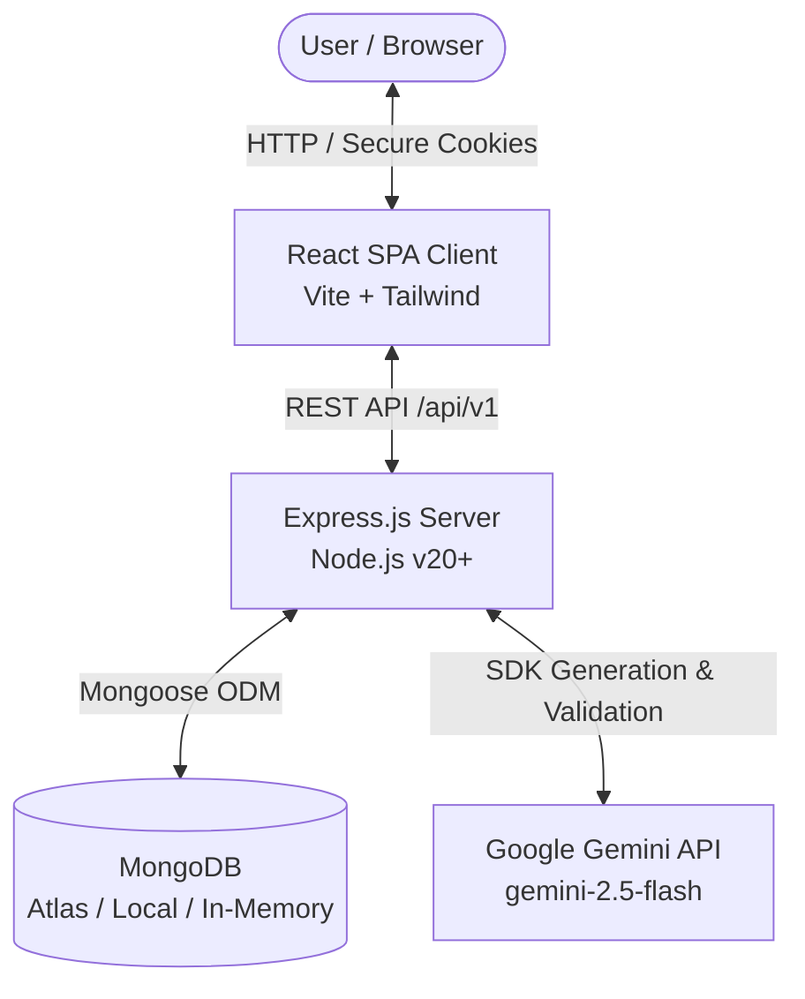

# AI Mystery Room — Architecture Documentation

## 1. System Overview

AI Mystery Room is a decoupled monorepo application consisting of a React client, Express API server, MongoDB database, and Google Gemini AI orchestration layer.

---

## 2. Core Subsystems

### 2.1 Backend Services
Located in `server/src/services/`:
- **`gemini.service.js`**: Wraps the official Google Gen AI SDK. Configured with model options, timeouts, and JSON-mode structured parsing.
- **`case-generation.service.js`**: Orchestrates the multi-stage mystery pipeline (Blueprint creation $\rightarrow$ Evidence generation $\rightarrow$ Consistency verification).
- **`case-validation.service.js`**: Deterministic Zod and rule-based integrity checks. Ensures one culprit, minimum 2 decisive clues, valid references, and timestamp coherence.
- **`evidence.service.js`**: Sanitizes public evidence artifacts, validates fictional metadata, and tracks discovery status.
- **`scoring.service.js`**: Computes case scores (up to 70 culprit points + 20 evidence exploration points + 10 decisive clues points).

### 2.2 Security Architecture & Data Partitioning
- **Secret Solution Separation**: Public case payloads never include `privateSolution` (culprit identity, secret motives, decisive clue mappings). These are stripped at the serialization layer and only revealed via `GET /cases/:caseId/result` after a verified accusation is stored.
- **Authentication**: JWT stored in HTTP-Only, SameSite, Secure cookies.
- **Input Sanitization**: User prompt is strictly parameterized and treated as untrusted fiction material, preventing prompt injection.
